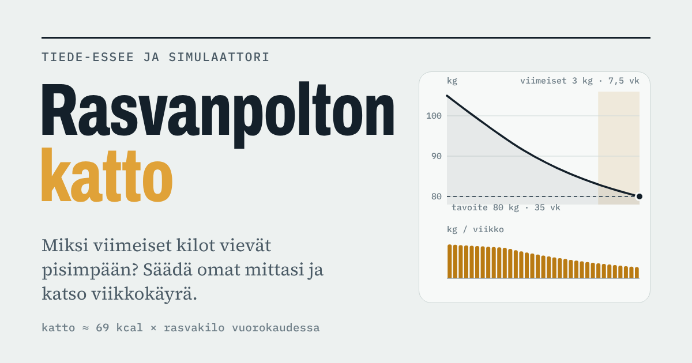

# Rasvanpolton katto

Simulaattori ja tiede-essee rasvavaraston energiansiirron ylärajasta: miksi laihdutuksen tahdin pitää hidastua, kun rasvaa on vähemmän, ja miten kulutus ja säästöliekki muuttuvat dieetin aikana.

**Sivu:** https://juusoj.github.io/rasvanpolton-katto/

## Sisältö

- **Simulaattori:** omat mitat liukusäätimillä, kehon sivuprofiili, viikkokäyrä, kulutus ja säästöliekki sekä oman syömisen laskelma.
- **Tiede-essee:** rasvavaraston katto (Alpert 2005), kudosten energiatiheydet (Hall 2008), kulutuksen muutokset ja säästöliekki (Hall ym. 2011, Dulloo & Jacquet 1998) sekä lähdeluettelo.

## Tiedostot

| Tiedosto | Tarkoitus |
|---|---|
| `index.html` | Koko sivu: simulaattori, essee, tyylit ja laskenta samassa tiedostossa |
| `favicon.svg`, `apple-touch-icon.png` | Selaimen välilehden ja puhelimen kotivalikon kuvake |
| `og-image.png` | Linkkiesikatselun kuva (WhatsApp, Facebook, Slack ym.) |

## Päivittäminen

Lataa uusi `index.html` saman nimisenä kohdasta *Add file → Upload files* ja vahvista *Commit changes*. GitHub Pages julkaisee muutoksen yleensä parissa minuutissa.

## Huomio

Luvut ovat suuntaa antavia arvioita, eivät lääketieteellisiä ohjeita. Sivu ei lähetä syötettyjä arvoja minnekään: ne tallentuvat vain käyttäjän omaan selaimeen.
